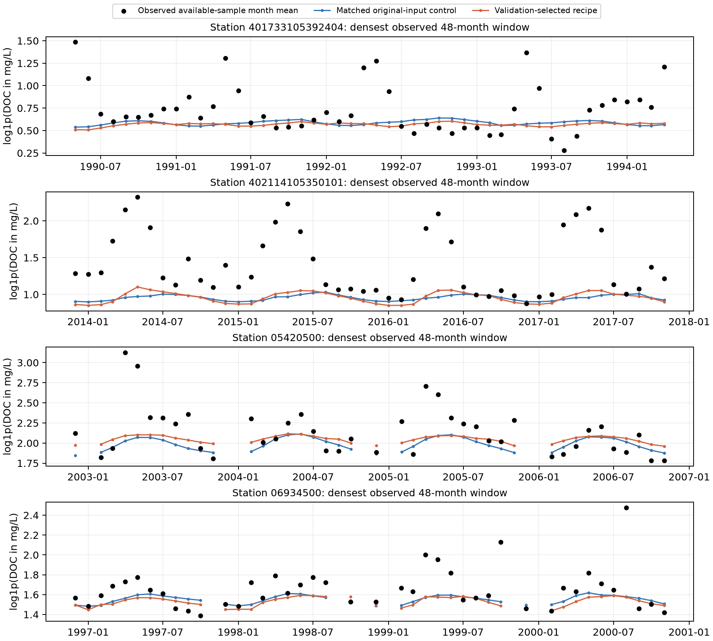

# RiverDOCNet dynamic reconstruction development results

The environment MLP, twelve-month GRU and upstream/downstream/global graph Transformer are retained. Four neural recipes are matched at 12,853 parameters. The original-input control is retrained under the new matched batching and runtime, so historical paper scores are not a causal control for this experiment.

A separately frozen execution amendment increased independent fit concurrency from four to eight with at most four simultaneous neural fits. Every task remains single-threaded; no scientific setting, seed, candidate, mask or selection rule changed. Existing running workers were adopted rather than restarted. The original protocol and prediction files were retained. See resource_amendment.json.

The source-validation rule selected **RiverDOCNet: daily-flow descriptors and log loss** before any target scoring. Native MAE and log-MAE remain primary. Temporal diagnostics do not change model selection.

## Spatial queries

| Model | mae | log1p_mae | rmse | r2 | station_centered_r2 | log1p_station_centered_r2 | within_station_sd_ratio | monthly_delta_mae | monthly_delta_correlation |
| --- | --- | --- | --- | --- | --- | --- | --- | --- | --- |
| RiverDOCNet: original inputs and log loss | 2.1958 | 0.3113 | 4.7403 | 0.4884 | 0.0114 | 0.0346 | 0.1345 | 1.8237 | 0.0338 |
| RiverDOCNet: daily-flow descriptors and log loss | 2.1495 | 0.2975 | 4.6704 | 0.5033 | 0.0121 | 0.0628 | 0.1522 | 1.8141 | 0.0914 |
| RiverDOCNet: original inputs and joint loss | 2.1978 | 0.3140 | 4.6599 | 0.5056 | 0.0134 | 0.0440 | 0.1392 | 1.8195 | 0.0568 |
| RiverDOCNet: daily-flow descriptors and joint loss | 2.1564 | 0.3023 | 4.7100 | 0.4949 | 0.0107 | 0.0559 | 0.1588 | 1.8199 | 0.0922 |
| History random forest: original inputs | 2.4625 | 0.3558 | 4.8088 | 0.4735 | -0.0092 | 0.0437 | 0.2024 | 1.8166 | 0.0981 |
| History random forest: daily-flow descriptors | 2.3974 | 0.3511 | 4.7957 | 0.4764 | -0.0009 | 0.0627 | 0.1713 | 1.8226 | 0.1111 |
| History XGBoost: original inputs | 2.3157 | 0.3420 | 4.7135 | 0.4942 | 0.0163 | 0.0457 | 0.1938 | 1.8363 | 0.1198 |
| History XGBoost: daily-flow descriptors | 2.2012 | 0.3279 | 4.5514 | 0.5282 | -0.0009 | 0.0482 | 0.1990 | 1.8484 | 0.1171 |

Each seed pools the same five held HUC4 regions (104 stations, 7,262 observed-query cells); reported metrics average three seeds, without prediction ensembling.

## 3-month temporal gaps

| Model | mae | log1p_mae | rmse | r2 | station_centered_r2 | log1p_station_centered_r2 | within_station_sd_ratio | monthly_delta_mae | monthly_delta_correlation |
| --- | --- | --- | --- | --- | --- | --- | --- | --- | --- |
| RiverDOCNet: original inputs and log loss | 2.2049 | 0.2432 | 5.8627 | 0.4783 | 0.0150 | 0.0681 | 0.1691 | 2.1612 | 0.1175 |
| RiverDOCNet: daily-flow descriptors and log loss | 2.2823 | 0.2478 | 6.0409 | 0.4426 | 0.0123 | 0.0900 | 0.1622 | 2.1550 | 0.0541 |
| RiverDOCNet: original inputs and joint loss | 2.2630 | 0.2524 | 6.0046 | 0.4527 | 0.0315 | 0.0894 | 0.1620 | 2.1424 | 0.0911 |
| RiverDOCNet: daily-flow descriptors and joint loss | 2.2402 | 0.2477 | 5.8556 | 0.4760 | 0.0496 | 0.1003 | 0.2353 | 2.1532 | 0.1784 |
| History random forest: original inputs | 2.0728 | 0.2243 | 5.6152 | 0.5190 | 0.0614 | 0.0820 | 0.2219 | 2.1148 | 0.2224 |
| History random forest: daily-flow descriptors | 2.0834 | 0.2234 | 5.7509 | 0.4971 | 0.0758 | 0.1309 | 0.2060 | 2.1095 | 0.2673 |
| History XGBoost: original inputs | 2.1099 | 0.2318 | 5.7688 | 0.4940 | 0.0715 | 0.0984 | 0.2370 | 2.1473 | 0.2281 |
| History XGBoost: daily-flow descriptors | 2.1171 | 0.2319 | 5.8002 | 0.4888 | 0.1071 | 0.1353 | 0.2648 | 2.1263 | 0.3121 |

## 6-month temporal gaps

| Model | mae | log1p_mae | rmse | r2 | station_centered_r2 | log1p_station_centered_r2 | within_station_sd_ratio | monthly_delta_mae | monthly_delta_correlation |
| --- | --- | --- | --- | --- | --- | --- | --- | --- | --- |
| RiverDOCNet: original inputs and log loss | 2.2128 | 0.2435 | 5.8667 | 0.4763 | 0.0031 | 0.0675 | 0.1656 | 2.1623 | 0.0844 |
| RiverDOCNet: daily-flow descriptors and log loss | 2.2855 | 0.2490 | 6.0047 | 0.4495 | 0.0150 | 0.0890 | 0.1694 | 2.1546 | 0.0732 |
| RiverDOCNet: original inputs and joint loss | 2.3000 | 0.2561 | 6.0452 | 0.4448 | 0.0363 | 0.0873 | 0.1637 | 2.1397 | 0.1253 |
| RiverDOCNet: daily-flow descriptors and joint loss | 2.2974 | 0.2554 | 5.9300 | 0.4623 | 0.0590 | 0.0987 | 0.2082 | 2.1483 | 0.2109 |
| History random forest: original inputs | 2.1169 | 0.2281 | 5.6820 | 0.5078 | 0.0353 | 0.0640 | 0.2377 | 2.1486 | 0.1602 |
| History random forest: daily-flow descriptors | 2.1274 | 0.2283 | 5.8452 | 0.4806 | 0.0435 | 0.1070 | 0.2102 | 2.1389 | 0.1926 |
| History XGBoost: original inputs | 2.1429 | 0.2350 | 5.7708 | 0.4934 | 0.0583 | 0.0929 | 0.2410 | 2.1560 | 0.2028 |
| History XGBoost: daily-flow descriptors | 2.1500 | 0.2347 | 5.8487 | 0.4798 | 0.0822 | 0.1245 | 0.2728 | 2.1258 | 0.2439 |

## 12-month temporal gaps

| Model | mae | log1p_mae | rmse | r2 | station_centered_r2 | log1p_station_centered_r2 | within_station_sd_ratio | monthly_delta_mae | monthly_delta_correlation |
| --- | --- | --- | --- | --- | --- | --- | --- | --- | --- |
| RiverDOCNet: original inputs and log loss | 2.2465 | 0.2465 | 5.9515 | 0.4617 | 0.0127 | 0.0609 | 0.1734 | 2.1763 | 0.0801 |
| RiverDOCNet: daily-flow descriptors and log loss | 2.2783 | 0.2487 | 6.0596 | 0.4394 | 0.0226 | 0.0989 | 0.1660 | 2.1468 | 0.0937 |
| RiverDOCNet: original inputs and joint loss | 2.3153 | 0.2585 | 5.9725 | 0.4572 | 0.0203 | 0.0631 | 0.1933 | 2.1605 | 0.0838 |
| RiverDOCNet: daily-flow descriptors and joint loss | 2.3722 | 0.2627 | 6.0915 | 0.4346 | 0.0382 | 0.0936 | 0.1646 | 2.1572 | 0.1268 |
| History random forest: original inputs | 2.1253 | 0.2290 | 5.7354 | 0.4974 | 0.0381 | 0.0674 | 0.2106 | 2.1349 | 0.1508 |
| History random forest: daily-flow descriptors | 2.1537 | 0.2315 | 5.9910 | 0.4538 | 0.0377 | 0.0873 | 0.1966 | 2.1580 | 0.1476 |
| History XGBoost: original inputs | 2.1634 | 0.2370 | 5.6634 | 0.5089 | 0.0701 | 0.1002 | 0.2227 | 2.1343 | 0.2499 |
| History XGBoost: daily-flow descriptors | 2.1740 | 0.2384 | 5.8512 | 0.4782 | 0.0768 | 0.1159 | 0.2436 | 2.1358 | 0.2257 |

## Paired uncertainty and limits

spatial_paired_bootstrap.csv reports recipe-minus-control differences using 10,000 paired resamples of the five HUC4 regions, with seeds retained and pooled-cell metrics recomputed. Five clusters give limited independent replication. These exploratory intervals are not adjusted for multiple comparisons. Time-gap repetitions are overlapping development masks, so their spread is not an independent basin confidence interval.

Station-centered R-squared removes each station's observed and predicted evaluation-period means separately and assesses fluctuations only. It is a diagnostic, not ordinary predictive R-squared, and uses evaluation labels only for scoring. SD ratios closer to one alone do not establish skill; delta error and concentration errors must also improve.

Station-balanced exploratory summaries are also reported in station_temporal_summary.csv: each eligible station has at least twelve query observations and positive observed log variance; per-station log-centered scores are summarized for each seed and then averaged across seeds. Constant predictions remain in centered-score and variance summaries; undefined correlations are reported separately. This checks whether pooled fluctuation scores are dominated by a few stations. It is not an additional primary endpoint or a selection criterion.

Temporal queries retain the parent protocol's fixed three-month scored cores while surrounding gaps increase. Results do not score every missing month in a twelve-month gap. All queries have observed DOC truth; naturally missing cells and arbitrary virtual river locations remain unvalidated.

The eight additional descriptors enrich within-month daily discharge variability on the existing monitoring footprint. They do not supply missing hydrology, meteorology or independent physical states. The target is the mean of available DOC samples in a calendar month. Raw-record support and rare high concentrations are audited without deleting frozen labels. Sampling support alone does not establish measurement error.

The protocol reuses previously inspected Mississippi development regions and masks. It is an optimization study, not an independent confirmation or a cross-river transfer claim.

## Illustrative observed curves

Four most densely observed spatial-query stations; earliest densest 48-month window per station, selected using label availability only. Seed 42 is illustrative, not a seed ensemble. Lines break across unobserved months.

Independent verification replays every selected checkpoint on both validation and query cells and confirms frozen labels, identical queries, source-only selection and metric recomputation. See analysis/independent_audit.json.
