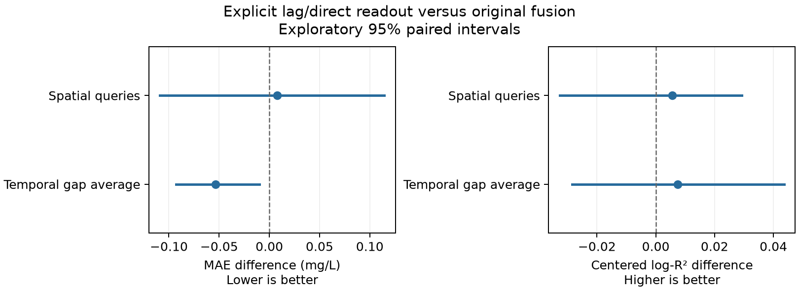

# RiverDOCNet explicit-history/direct-readout results

The update improves temporal concentration MAE/log-MAE relative to the matched original, but does not beat history random forest or XGBoost on those temporal point scores. Temporal change reconstruction does not improve consistently. Spatial MAE/log-MAE point scores deteriorate slightly while RMSE and predictive R-squared improve.

The three information components are retained. The candidate adds a flattened-history MLP and a direct local readout. It was fixed before target scoring. All new checkpoints were selected solely using native validation MAE.

Only 24 new candidate fits were needed. The 72 original/control fit packages are immutable reused dependencies. All 96 comparison packages and both prediction roles were independently replayed. Inputs, original labels, masks and normalization are matched. Tree controls use the same local environmental/history information without DOC context or river messages.

The first frozen verification entry omitted initialization of the pinned XGBoost dependency path. A separately recorded wrapper loaded the unchanged parent dependency set and executed the unchanged frozen numerical verifier. No fitting, selection, predictions or metrics were modified. Its exact executed source is retained in evaluation_code_snapshot and bound by verification_environment_repair.json and evaluation_source_receipt.json.

The original has 12,853 parameters; the update has 17,617 (+37.07%). The eight unused daily channels remain zero. Shared backbone initialization, original log loss, batching, optimizer and 60-epoch budget are retained. The comparison tests the combined architecture/capacity change, not isolated causal effects of either addition.

## Spatial reconstruction

| Model | mae | log1p_mae | rmse | r2 |
| --- | --- | --- | --- | --- |
| RiverDOCNet: original fusion | **2.1958** | **0.3113** | 4.7403 | 0.4884 |
| RiverDOCNet: explicit lag and direct readout | 2.2038 | 0.3234 | **4.6078** | **0.5159** |
| History random forest | 2.4625 | 0.3558 | 4.8088 | 0.4735 |
| History XGBoost | 2.3157 | 0.3420 | 4.7135 | 0.4942 |

Metrics pool the same 7,262 observed queries at 104 held-out stations across five HUC4 regions within seed, then average three seeds.

## Temporal gap average

| Model | mae | log1p_mae | rmse | r2 |
| --- | --- | --- | --- | --- |
| RiverDOCNet: original fusion | 2.2214 | 0.2444 | 5.8936 | 0.4721 |
| RiverDOCNet: explicit lag and direct readout | 2.1677 | 0.2376 | 5.8128 | 0.4865 |
| History random forest | **2.1050** | **0.2271** | **5.6775** | **0.5081** |
| History XGBoost | 2.1387 | 0.2346 | 5.7343 | 0.4988 |

| Model | station_centered_r2 | log1p_station_centered_r2 | within_station_sd_ratio | monthly_delta_mae | monthly_delta_correlation |
| --- | --- | --- | --- | --- | --- |
| RiverDOCNet: original fusion | 0.0103 | 0.0655 | 0.1694 | 2.1666 | 0.0940 |
| RiverDOCNet: explicit lag and direct readout | 0.0043 | 0.0730 | 0.2174 | 2.1904 | 0.0989 |
| History random forest | 0.0449 | 0.0711 | 0.2234 | **2.1328** | 0.1778 |
| History XGBoost | **0.0666** | **0.0972** | 0.2336 | 2.1459 | **0.2269** |

The overview is the equal mean of the three declared gap lengths and three mask/optimization seeds. Query cores are reused across gaps; these are not nine independent repetitions.

## 3-month surrounding gaps

| Model | mae | log1p_mae | rmse | r2 |
| --- | --- | --- | --- | --- |
| RiverDOCNet: original fusion | 2.2049 | 0.2432 | 5.8627 | 0.4783 |
| RiverDOCNet: explicit lag and direct readout | 2.1498 | 0.2361 | 5.8092 | 0.4879 |
| History random forest | **2.0728** | **0.2243** | **5.6152** | **0.5190** |
| History XGBoost | 2.1099 | 0.2318 | 5.7688 | 0.4940 |

## 6-month surrounding gaps

| Model | mae | log1p_mae | rmse | r2 |
| --- | --- | --- | --- | --- |
| RiverDOCNet: original fusion | 2.2128 | 0.2435 | 5.8667 | 0.4763 |
| RiverDOCNet: explicit lag and direct readout | 2.1825 | 0.2397 | 5.8421 | 0.4820 |
| History random forest | **2.1169** | **0.2281** | **5.6820** | **0.5078** |
| History XGBoost | 2.1429 | 0.2350 | 5.7708 | 0.4934 |

## 12-month surrounding gaps

| Model | mae | log1p_mae | rmse | r2 |
| --- | --- | --- | --- | --- |
| RiverDOCNet: original fusion | 2.2465 | 0.2465 | 5.9515 | 0.4617 |
| RiverDOCNet: explicit lag and direct readout | 2.1708 | 0.2371 | 5.7872 | 0.4895 |
| History random forest | **2.1253** | **0.2290** | 5.7354 | 0.4974 |
| History XGBoost | 2.1634 | 0.2370 | **5.6634** | **0.5089** |

## Changes relative to original fusion

| Metric | Temporal error reduction (%) | Spatial error reduction (%) |
| --- | --- | --- |
| mae | 2.419 | -0.364 |
| log1p_mae | 2.781 | -3.887 |
| rmse | 1.371 | 2.794 |
| monthly_delta_mae | -1.100 | -0.173 |

## Interpretation

Temporal concentration MAE falls from 2.2214 to 2.1677 mg/L (2.42%), and log-MAE falls by 2.78%. Every one of the nine fixed gap/mask/seed combinations has lower native MAE than the original. The exploratory HUC4-blocked equal-task intervals for both primary changes exclude zero; this is conditional development evidence, not independent confirmation.

The temporal MAE remains above history random forest (2.1050) and history XGBoost (2.1387) at every gap length. Their log-MAE point scores are also lower. Differences against the trees have wide intervals including zero, so neither stable population inferiority nor superiority is established. The tested update has not achieved the intended temporal benchmark lead.

Temporal native station-centered R-squared falls from 0.0103 to 0.0043. Monthly change MAE rises from 2.1666 to 2.1904 mg/L and exceeds the zero-change reference (2.1840). The variability ratio rises from 0.169 to 0.217, but increased amplitude is not increased dynamic accuracy. The small log-centered and delta-correlation gains have intervals including zero.

Spatial MAE increases by 0.36% and log-MAE by 3.89%. Both primary difference intervals include zero. RMSE improves by 2.79%; the update still has lower spatial primary point errors than the two tree controls. Thus spatial competitiveness is retained, but a joint-primary upgrade over original fusion is not established.

This is a useful but incomplete concentration-accuracy improvement. It does not justify declaring a final temporal-dynamics model or SOTA. The result shows that the proposed combination of explicit lag encoding and direct readout, at this fixed training budget, is insufficient to resolve the gap to strong tree baselines. The bundle and added capacity prevent attribution to either architectural addition alone. No additional training or model selection is performed by this report.

## Paired differences and uncertainty

| Track | Reference | Metric | New minus reference | Lower 95% | Upper 95% |
| --- | --- | --- | --- | --- | --- |
| space | RiverDOCNet: original fusion | mae | 0.00800 | -0.10880 | 0.11442 |
| space | RiverDOCNet: original fusion | log1p_mae | 0.01210 | -0.01637 | 0.03942 |
| space | RiverDOCNet: original fusion | log1p_station_centered_r2 | 0.00565 | -0.03262 | 0.02920 |
| space | RiverDOCNet: original fusion | monthly_delta_mae | 0.00316 | -0.00978 | 0.01757 |
| space | History random forest | mae | -0.25872 | -0.49949 | -0.11062 |
| space | History random forest | log1p_mae | -0.03237 | -0.05252 | -0.01329 |
| space | History random forest | log1p_station_centered_r2 | -0.00352 | -0.06443 | 0.05749 |
| space | History random forest | monthly_delta_mae | 0.01024 | -0.00452 | 0.01785 |
| space | History XGBoost | mae | -0.11195 | -0.32228 | 0.03202 |
| space | History XGBoost | log1p_mae | -0.01851 | -0.04868 | 0.00520 |
| space | History XGBoost | log1p_station_centered_r2 | -0.00543 | -0.05095 | 0.04378 |
| space | History XGBoost | monthly_delta_mae | -0.00945 | -0.04602 | 0.01112 |
| time | RiverDOCNet: original fusion | mae | -0.05375 | -0.09264 | -0.00971 |
| time | RiverDOCNet: original fusion | log1p_mae | -0.00680 | -0.01284 | -0.00068 |
| time | RiverDOCNet: original fusion | log1p_station_centered_r2 | 0.00752 | -0.02835 | 0.04363 |
| time | RiverDOCNet: original fusion | monthly_delta_mae | 0.02382 | -0.00102 | 0.04663 |
| time | History random forest | mae | 0.06267 | -0.02516 | 0.14512 |
| time | History random forest | log1p_mae | 0.01047 | -0.00116 | 0.02231 |
| time | History random forest | log1p_station_centered_r2 | 0.00192 | -0.05880 | 0.07291 |
| time | History random forest | monthly_delta_mae | 0.05762 | -0.00462 | 0.11603 |
| time | History XGBoost | mae | 0.02896 | -0.05735 | 0.10434 |
| time | History XGBoost | log1p_mae | 0.00300 | -0.00696 | 0.01290 |
| time | History XGBoost | log1p_station_centered_r2 | -0.02412 | -0.07401 | 0.03011 |
| time | History XGBoost | monthly_delta_mae | 0.04455 | -0.01492 | 0.09462 |

Intervals use 10,000 paired HUC4-block resamples with identical weights across methods, seeds and gap lengths, pooling sufficient statistics within seed and then averaging. Spatial inference has only five clusters; temporal inference has 61 clusters. The reused development cohort, shared training sets, basin connectivity and unadjusted multiple comparisons limit interpretation. Gap-zero temporal differences refer to equal-task averages, not pooled duplicate core observations.

Station-centered diagnostics remove each station's observed and predicted evaluation means separately. They do not measure concentration calibration or use DOC values as inference inputs. A standard-deviation ratio closer to one alone does not establish improved reconstruction. Changes compare consecutive observed months only.

The target remains the mean of available DOC samples in a calendar month, often one sampling day. The observed-query evaluation does not validate naturally missing cells, true continuously sampled monthly means, daily DOC or arbitrary river locations. Higher scores on this development comparison do not establish global SOTA, cross-river transfer or optimal components.

Evidence: summary.csv, by_seed.csv, temporal_overview.csv, paired_bootstrap.csv and independent_audit.json under experiments/phase4_transfer/doc_hybrid_fusion_v1/analysis. Baseline dependencies and runtime/dataset/mask hashes are bound by protocol.json and manifest.json.
